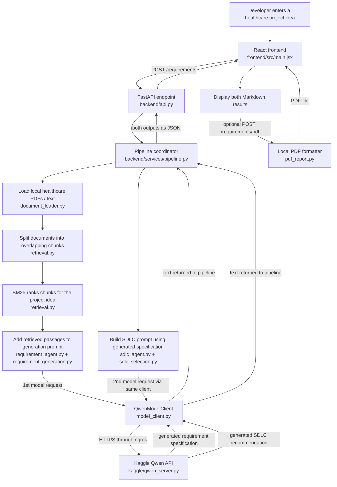
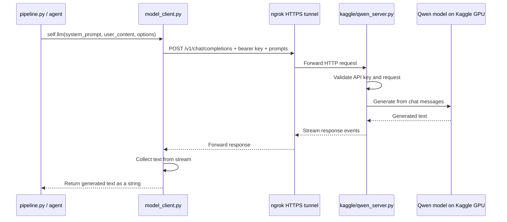

# Healthcare Requirement Engineering Pipeline

This project helps a **developer, requirements engineer, or software project team** turn a healthcare software idea into a draft requirements specification and an SDLC recommendation. It is a planning tool; patients and clinicians are possible users of the system being designed, not users of this app.

The app retrieves relevant passages from local healthcare documents, adds them to a prompt, and asks Qwen to generate the results. The React frontend and FastAPI backend run locally. Qwen runs on Kaggle, and the backend reaches it through an authenticated ngrok tunnel.

## Whole workflow at a glance

The diagram below shows the complete flow from the user entering an idea to viewing or downloading the results.



## Process, step by step

### Before using the app: start the remote model

1. Open `kaggle/qwen_server_kaggle.ipynb` in Kaggle and run its cells. The notebook prepares the Kaggle environment, uses Kaggle secrets for credentials, starts the Qwen server, and creates an ngrok tunnel.
2. The server code in `kaggle/qwen_server.py` loads `Qwen/Qwen3-4B-Instruct-2507` onto the Kaggle GPU and exposes an authenticated chat-completions endpoint.
3. Copy the current ngrok URL into `MODEL_API_BASE_URL` in `backend/.env`, with `/v1` appended. Set `MODEL_API_KEY` to the same secret used by the Kaggle server. Keep the Kaggle session and tunnel running while generating results.

The notebook is the **launcher/setup**; `qwen_server.py` contains the **server and model request-handling logic**. The backend sends prompts and receives generated text. It does not send the PDF corpus to Kaggle or load the model locally.

### When the user generates a report

1. **The browser submits the idea.** The user types a project description into the React page. `frontend/src/main.jsx` sends it as JSON to the local backend's `POST /requirements` endpoint.
2. **FastAPI starts the workflow.** `backend/api.py` validates the request and calls `RequirementEngineeringPipeline.run()`.
3. **The pipeline retrieves domain evidence.** `backend/services/pipeline.py` starts the LangGraph workflow. `document_loader.py` reads local healthcare PDFs, Markdown, and text files. `retrieval.py` splits their text into overlapping chunks and uses BM25 keyword ranking to select relevant passages for the submitted idea.
4. **The first generation request creates the requirement specification.** The pipeline combines the project idea and retrieved passages according to `prompts/requirement_generation.py`. In `_prd_node()`, it calls `self.llm(...)`. `self.llm` is a `QwenModelClient` created by `models/llm.py`.
5. **The model client sends the request to Kaggle.** `services/model_client.py` packages the system prompt, user prompt, model ID, and generation limits into an HTTP request to `{MODEL_API_BASE_URL}/chat/completions`. It adds the bearer API key and reads the streamed response. Since the configured base URL ends in `/v1`, this resolves to Kaggle's `/v1/chat/completions` route.
6. **Kaggle runs Qwen and returns text.** `kaggle/qwen_server.py` checks the API key, applies Qwen's chat template, runs generation on the GPU, and streams the generated text back. `model_client.py` collects that response and returns it as a normal Python string to the pipeline. The pipeline stores it as `prd_spec`.
7. **The second generation request recommends an SDLC.** The pipeline passes `prd_spec` into `agents/sdlc_agent.py`. That agent combines the specification with `prompts/sdlc_selection.py` and calls the same `self.llm(...)` client. This sends a second HTTP request to the same Kaggle endpoint. Qwen's response comes back through `model_client.py` and is stored as the SDLC recommendation.
8. **The backend returns both results.** The pipeline returns a `PipelineResult`; `api.py` turns it into JSON containing the original idea, requirement specification, and SDLC recommendation.
9. **The frontend displays the answer.** `main.jsx` renders both generated Markdown texts. If the user selects **Download PDF**, the frontend sends the displayed result to `POST /requirements/pdf`; the local backend formats it with `services/pdf_report.py` and returns a PDF download.

### Backend ↔ Kaggle: one request and response

This is what happens for **each** generation call. It happens twice: first for requirements, then for SDLC.



The key relationship is: **`pipeline.py` decides what to ask and what happens next; `model_client.py` sends each request to Qwen and returns its answer.** `self.llm(...)` invokes the client's `__call__` method. The same client object is reused for both model requests.

## RAG: where retrieval, augmentation, and generation happen

- **Retrieval:** `backend/services/document_loader.py` loads the source files; `backend/services/retrieval.py` chunks them and selects passages using BM25.
- **Augmentation:** the retrieved passages are inserted into the requirements prompt in `backend/agents/requirement_agent.py` / `backend/services/pipeline.py` using the template in `backend/prompts/requirement_generation.py`.
- **Generation:** Qwen generates the requirement specification through `model_client.py` and the Kaggle server. The SDLC recommendation is a second generation call, based on the generated specification.

The current retrieval implementation is BM25 keyword retrieval, not vector similarity search.

## Main folders and files

```text
backend/
  agents/                  Requirement and SDLC generation functions
  data/healthcare_documents/ Source PDFs used as retrieval evidence (PRD, SRS, Others)
  data/chroma_db/          Chroma database artifact; not used by the current BM25 pipeline
  infrastructure/config.py Environment settings and paths
  models/documents.py      Document, chunk, workflow-state, and result data structures
  models/llm.py            Builds the Qwen model client
  prompts/                 Instructions for requirements and SDLC generation
  services/document_loader.py Loads PDF/Markdown/text source material
  services/retrieval.py    Chunking and BM25 search
  services/model_client.py HTTP client that sends prompts to Kaggle and reads responses
  services/pipeline.py     Orchestrates retrieval, first generation, and second generation
  services/pdf_report.py   Builds the downloadable PDF locally
  api.py                   FastAPI endpoints for generation, health, and PDF download
  server.py                Starts the local API with Uvicorn
  main.py                  Optional command-line pipeline entry point
  requirements.txt         Python dependencies
  .env.example             Backend environment-variable template
frontend/
  src/main.jsx             React input, API calls, result display, and PDF download
  src/styles.css           Frontend styling
  index.html               HTML page where React mounts
  vite.config.js           Vite development-server configuration
  package.json             Frontend dependencies and commands
  package-lock.json        Locked JavaScript dependency versions
  .env.example             Frontend environment-variable template
kaggle/
  qwen_server.py           Authenticated Qwen inference API
  qwen_server_kaggle.ipynb Kaggle setup and server/tunnel launcher
  README.md                Kaggle-specific setup guide
```

Other files at the repository root include the assignment brief (`Problem Statement (8).pdf`), the original task description (`task.txt`), and a separate notebook (`software-eng-assignment (1).ipynb`).

## Run the project

### 1. Start Qwen on Kaggle

Follow [`kaggle/README.md`](kaggle/README.md) to set the Kaggle secrets and run [`qwen_server_kaggle.ipynb`](kaggle/qwen_server_kaggle.ipynb). Copy the printed ngrok URL.

### 2. Configure local environment files

Copy `backend/.env.example` to `backend/.env` and `frontend/.env.example` to `frontend/.env` if these files do not exist. Configure the backend's `MODEL_API_BASE_URL` to the active ngrok URL with `/v1` appended, and use the matching `MODEL_API_KEY`. Set the frontend's `VITE_API_URL` to the local FastAPI address. Keep real `.env` files private. Restart the backend when the ngrok URL changes.

### 3. Start the backend

```bash
cd backend
python -m venv .venv
source .venv/bin/activate
pip install -r requirements.txt
python server.py
```

### 4. Start the frontend in a second terminal

```bash
cd frontend
npm install
npm run dev
```

Open the Vite development URL, enter a project idea, and generate the report. The Kaggle notebook and tunnel must remain active while Qwen is generating.

## Configuration reference

| Variable | Location | Purpose |
|---|---|---|
| `MODEL_API_BASE_URL` | `backend/.env` | Active Kaggle ngrok URL with `/v1` appended |
| `MODEL_API_KEY` | `backend/.env` and Kaggle secret | Shared bearer key for the model endpoint |
| `MODEL_ID` | Backend and Kaggle environment | Model identifier; defaults to `Qwen/Qwen3-4B-Instruct-2507` |
| `MODEL_API_TIMEOUT` | `backend/.env` | Maximum time to wait for the model endpoint |
| `DOCUMENT_DIRECTORY` | `backend/.env` | Local source-document directory |
| `REQUIREMENT_SPEC_TOKENS`, `SDLC_TOKENS` | `backend/.env` | Output token limits for the two generation steps |
| `REQUIREMENT_GENERATION_MAX_SECONDS`, `SDLC_GENERATION_MAX_SECONDS` | `backend/.env` | Per-step generation time limits |
| `API_HOST`, `API_PORT` | `backend/.env` | Local API bind address and port |
| `CORS_ORIGINS` | `backend/.env` | Browser origins allowed by FastAPI |
| `VITE_API_URL` | `frontend/.env` | Local FastAPI address used by the browser |
| `VITE_DEV_HOST`, `VITE_DEV_PORT` | `frontend/.env` | Vite development-server address and port |
